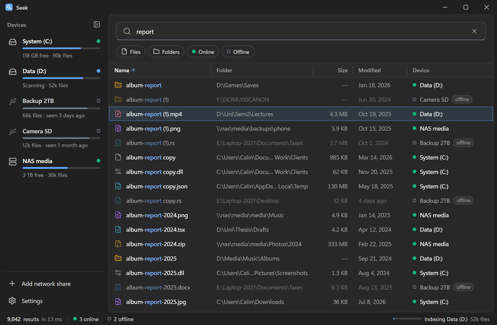
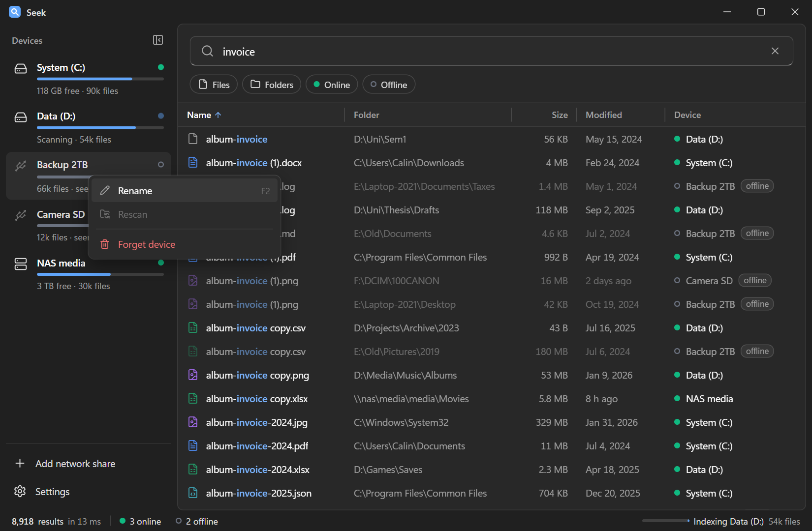
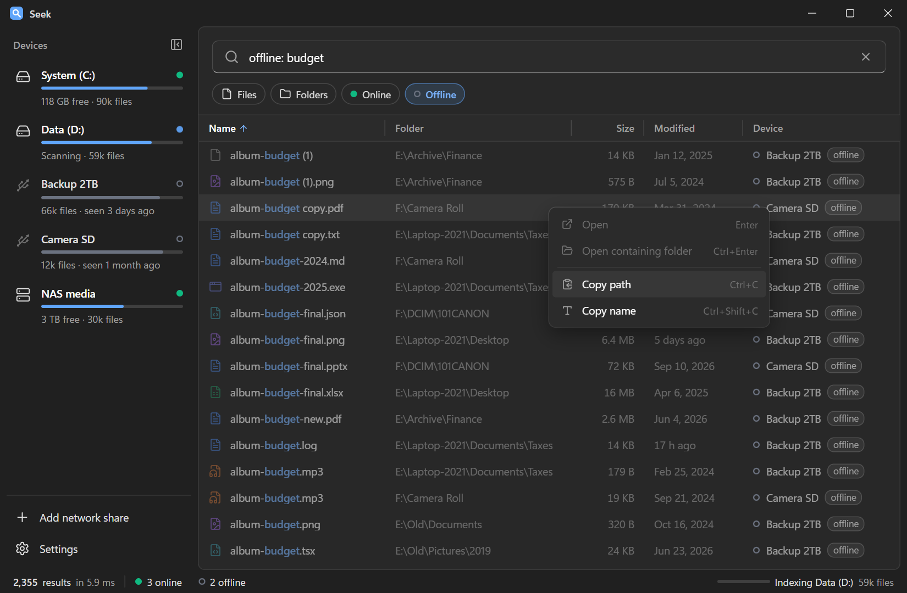
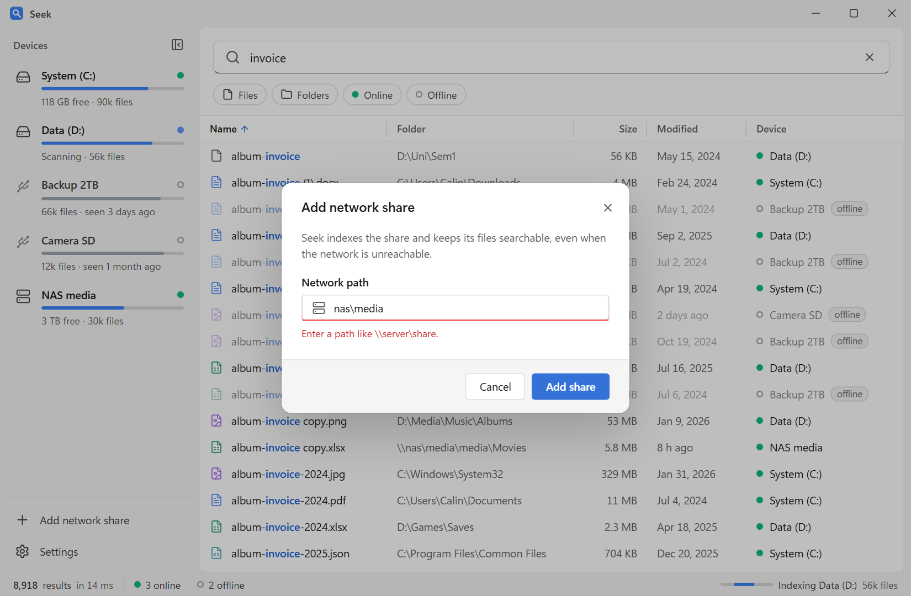
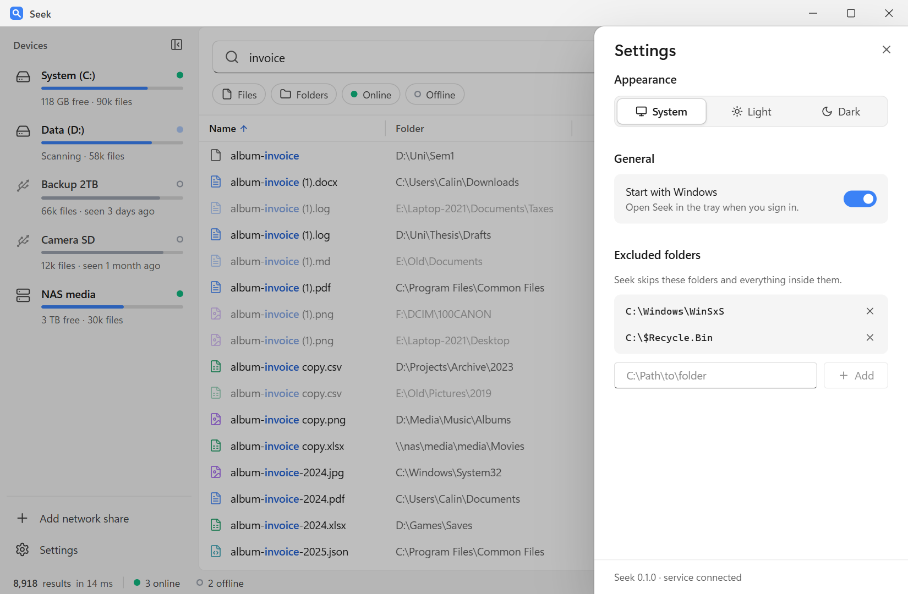
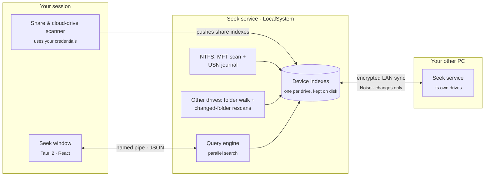

<div align="center">


# Seek

**Instant file-name search for Windows that never forgets a drive.**

Type a few letters and get every matching file on every disk in milliseconds. That includes USB sticks,
backup drives and NAS shares that aren't plugged in right now.

[](#install)
[](crates/)
[](app/)
[](#license)
[](docs/NEXT_STEPS.md)

<br>

<picture>
  <source media="(prefers-color-scheme: dark)" srcset="docs/assets/hero-dark.svg">
  <source media="(prefers-color-scheme: light)" srcset="docs/assets/hero-light.svg">
  
</picture>

</div>

---

## Why Seek

Tools like *Everything* made instant file search normal on Windows, but they forget a drive as soon as you
unplug it. **Seek keeps every device it has ever indexed.** When you search for `thesis final`, you also
find the copy on the backup disk in your drawer. Seek shows which drive the file is on, where it was, and
when the drive was last connected.

<table>
<tr>
<td width="33%" valign="top">

### ⚡ Instant
Searches 2.8 million files in **1.7–7.5 ms** on a typical laptop. The index is a compact, column-oriented
structure in memory, and searches run on every CPU core.

</td>
<td width="33%" valign="top">

### 💾 Remembers offline drives
Unplugged drives stay searchable, with their folder, size, dates and *last seen*. A reformatted drive
shows up as a new device, and the old one stays.

</td>
<td width="33%" valign="top">

### 🔄 Always current
NTFS drives follow the **USN change journal**, so new files show up within seconds. Other drives are
watched, and **only the folders that changed** are rescanned.

</td>
</tr>
<tr>
<td valign="top">

### 🗄️ Every kind of drive
Internal NTFS disks, USB sticks (FAT32 / exFAT), network shares (`\\nas\media`) and cloud drives like
Google Drive. **Link your other PCs** and search their drives too, even while they're switched off.

</td>
<td valign="top">

### ⌨️ A real query language
`report ext:pdf size:>1mb dm:2025 !draft`: filters, wildcards, regex, OR and NOT. Typing never blocks,
and errors are shown inline.

</td>
<td valign="top">

### 🔒 Private by design
No accounts, no telemetry, no cloud. Linked PCs exchange only file names, encrypted, over your local
network. Other users can't see your profile folder.

</td>
</tr>
</table>

## Screenshots

<picture>
  <source media="(prefers-color-scheme: dark)" srcset="app/docs/screenshots/02-results-dark.png">
  <source media="(prefers-color-scheme: light)" srcset="app/docs/screenshots/02-results-light.png">
  
</picture>

<details>
<summary><b>More screenshots</b></summary>
<br>

| | |
|---|---|
|  |  |
| Rename, rescan or forget a device | Results from offline drives say where the file lived |
|  |  |
| Add a NAS share by its path | Settings, in light mode |

</details>

## Search syntax

| Query | Finds |
|---|---|
| `foo bar` | names containing **foo** *and* **bar** (case-insensitive) |
| `foo \| bar` | names containing **foo** *or* **bar** |
| `!foo` | names **not** containing foo |
| `"exact phrase"` | a literal, spaces included |
| `*.pdf`, `rep?rt` | wildcards (matched against the whole name) |
| `ext:pdf;docx` | by extension |
| `size:>100mb`, `size:1kb..5mb` | by size |
| `dm:2025`, `dm:>2025-06-01`, `dm:today` | by date modified |
| `path:work\clients` | match against the full path instead of the name |
| `regex:^IMG_\d{4}\.jpe?g$` | regular expression on the name |
| `drive:backup` | only one drive |
| `device:laptop` | only one device (one of your linked PCs), or a drive with that name |
| `folder:` · `file:` | only folders · only files |
| `online:` · `offline:` | only connected · only disconnected devices |

Combine them freely, for example `invoice ext:pdf dm:2025 device:nas !draft`.

## Performance

These figures are from a real machine (non-elevated, so drives were indexed with the slower folder walk)
and from synthetic benchmarks. Run them yourself with `seek perf`.

| | Result | Target |
|---|---|---|
| Typical query over **2.8 M** entries | **1.7 – 7.5 ms** | < 50 ms |
| Query `report` over **10 M** synthetic entries | **17.8 ms** | < 50 ms |
| Sort 2 M results by size | 33 ms | |
| Load a 2 M-entry index from disk | 327 ms | < 1 s |
| Index D: (718 k entries, folder walk) | 14 s | |
| Service memory with 2.8 M entries | ~370 MB | |
| New file visible in search (watched drive) | 2–4 s | < 2 s |

## Install

> [!NOTE]
> Seek is in early development and there are no release builds yet. You can build the installer from
> source, as shown below.

1. Build the installer: `.\scripts\build-installer.ps1`. It produces
   `target\release\bundle\nsis\Seek_<version>_x64-setup.exe`.
2. Run it. It installs Seek for all users and registers the **Seek indexing service**. This is the only
   admin prompt you'll see.
3. Open **Seek** from the Start menu. Closing the window keeps Seek in the tray.

To uninstall, use **Settings → Apps**. The service is removed, and your indexes in `%ProgramData%\Seek`
are kept in case you reinstall.

<details>
<summary><b>Build and run from source</b></summary>
<br>

**Requirements:** Windows 10/11, [Rust](https://rustup.rs) (stable), [Node.js](https://nodejs.org) 20+ and
[pnpm](https://pnpm.io).

```powershell
git clone https://github.com/CalinASandu/seek.git
cd seek
.\Seek.bat               # builds everything on first run, starts the service and opens the window
```

`Seek.bat` asks for admin rights once. Click **Yes** for fast NTFS indexing and live updates. Click **No**
to run without them, which indexes with the slower folder walk and a folder watcher. `Stop Seek.bat`
stops it.

| Task | Command |
|---|---|
| Tests | `cargo test --workspace` · `cd app; pnpm test` |
| Lint | `cargo clippy --workspace --all-targets -- -D warnings` |
| Service + CLI | `cargo build --release -p seek-service -p seek-cli` |
| Window | `cd app; pnpm tauri build --no-bundle` |
| UI with mock data (browser) | `cd app; pnpm dev` → http://localhost:1420 |
| Search from the terminal | `.\target\release\seek.exe remote "ext:pdf" --sort size --desc` |
| Benchmarks | `.\scripts\perf.ps1` (compares with the previous run) |

</details>

## How it works



- **One service owns every index.** It runs as a Windows service, so it can read the NTFS Master File Table
  directly. This indexes about a million files in seconds without asking for admin rights on every launch.
- **Each device gets its own index file** (`%ProgramData%\Seek\indexes\<device>.seekidx`). An unplugged
  drive just stops getting updates, and its index stays searchable.
- **Live updates:**
  - NTFS drives follow the USN change journal.
  - Every other drive is watched. When something changes, Seek rescans **only the folders that changed**
    and walks any new folders completely. A full rescan only happens if Windows reports that events were
    lost.
- **Network shares** are scanned by the app in your session, because the service can't use your network
  credentials. The app then hands the index to the service.
- **Sync between your PCs:** link two PCs once with a 6-digit code (SPAKE2, so the code can't be guessed
  offline). Each PC then keeps a copy of the other's indexes, sent once in full and afterwards as small change
  batches every minute, over an encrypted, mutually authenticated connection (Noise IK) on your local network.
  PCs find each other with mDNS; up to 5 PCs per group. A copy stays searchable while its PC is off.
- **Privacy:** the service answers only local clients. A client started with *Run as administrator* sees
  every file. Any other client sees everything except other users' profile folders.

<details>
<summary><b>Project layout</b></summary>
<br>

| Path | What |
|---|---|
| `crates/seek-core` | OS-independent core: column index, query parser, parallel search, persistence, device registry |
| `crates/seek-scan` | Windows scanners: volumes, raw MFT reader, USN follower, folder walker, watcher |
| `crates/seek-ipc` | Named-pipe protocol (length-prefixed JSON), client and server |
| `crates/seek-sync` | OS-independent sync: change journal, Noise transport, SPAKE2 pairing, linked PCs, sync session |
| `crates/seek-service` | The indexing service: devices, scans, live updates, access rules, sync with linked PCs |
| `crates/seek-cli` | `seek` command line: scan, query, remote search, benchmarks |
| `app/` | The desktop app: React UI and Tauri backend (tray, shares, settings) |
| `docs/` | Design spec, implementation plan and [current status](docs/NEXT_STEPS.md) |

</details>

## Roadmap

- [x] Instant search across every local drive, network share and cloud drive
- [x] Offline devices stay searchable
- [x] Live updates (USN journal; changed-folder rescans everywhere else)
- [x] Windows installer with background service
- [x] Sync between your own PCs on the local network
- [ ] Optional self-hosted sync server
- [ ] macOS and Linux
- [ ] Content search and duplicate finder

## License

Licensed under either of [Apache License 2.0](LICENSE-APACHE) or [MIT](LICENSE-MIT), at your option.

<div align="center"><sub>Built with Rust, Tauri and React · a university project</sub></div>
